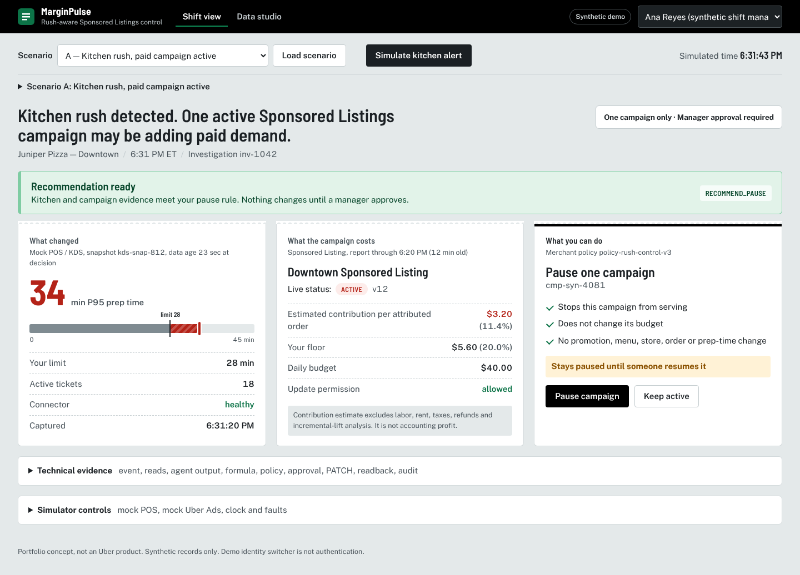

# MarginPulse — Rush-Aware Sponsored Listings Control

A runnable portfolio prototype of one bounded workflow: when a restaurant's kitchen passes the merchant's own limit while a Sponsored Listings campaign is active, MarginPulse investigates, calculates an estimated contribution in deterministic code, recommends pausing exactly one campaign, waits for a manager's click, sends one PATCH to a stateful **mock** of the Uber Ads API, reads the campaign back, and shows the verified result with an audit trail.

> **Portfolio concept, not an Uber product.** All records are synthetic. Uber Ads and the POS/KDS are local behavioral simulators. Nothing calls a live Uber or POS service in the default build.



## Quick start

Requirements: **Node.js 22.13+** (uses the built-in `node:sqlite`; tested on 22.22.0). No accounts, keys or network services are needed.

```bash
npm install
npm start            # builds the UI, starts API + both simulators on http://127.0.0.1:8787
```

Open http://127.0.0.1:8787. The database is created at `data/marginpulse.db` and seeded with scenario A.

| Command | What it does |
|---|---|
| `npm start` | Build the React UI and serve everything on port 8787 |
| `npm run dev` | API with watch + Vite dev server on http://127.0.0.1:5173 (proxied) |
| `npm run reset -- A` | Reset the local DB to a scenario (A–R) |
| `npm run template` | Regenerate the sample workbook and valid/invalid import fixtures in `data/templates/` |
| `npm run typecheck` / `npm run lint` | TypeScript strict check / ESLint |
| `npm test` | Unit + integration tests (Vitest, real HTTP against in-memory DB) |
| `npm run test:e2e` | Browser tests (Playwright + Chromium) |
| `npm run test:all` | Typecheck, lint, Vitest, Playwright and the secret scan |
| `npm run build` | Typecheck and production UI build |

## Three-minute demo

1. **Load scenario A** and press **Simulate kitchen alert**. The mock POS builds a `KitchenLoadThresholdBreached` event from its latest KDS snapshot, signs it with HMAC and delivers it to the MarginPulse webhook over HTTP.
2. Read the three cards: P95 34 min against a 28 min limit (the rail), the campaign with an estimated **$3.20** contribution per attributed order against a **$5.60** floor, and the one action on offer. Note the report watermark and *"Stays paused until someone resumes it"*.
3. Open **Simulator controls** — the campaign table shows what Mock Uber Ads reports *right now* (ACTIVE, v12, 0 PATCH requests).
4. Press **Pause campaign**, read the confirmation, confirm. The result panel shows configured **PAUSED**, effective **PAUSED**, version **13**, 1 PATCH, other mutations **None** — all from readback, not from the button press.
5. Open **Technical evidence**: event, tool reads with evidence ids (`kds-snap-812`, `campaign-read-cmp-syn-4081-v12`, `calc-881`), investigator output and validation, policy checks, approval, redacted PATCH request, readbacks and the hash-chained audit timeline.
6. Try a failure: load **G**, simulate, then *Simulator → Another manager edits the campaign*, then Pause → **Blocked: campaign changed**, zero PATCHes; *Re-assess with fresh data* needs a new approval. Or **J** (paused but still serving → *Check again*), **I** (connection drops after apply → verified from readback, no retry), **M** (429 → truthful not-applied status → retry).
7. **Data studio**: download the sample workbook, upload `data/templates/invalid/stale-revision.xlsx` (row-level rejection, commit disabled), then merge `data/templates/valid/merge-threshold-40.xlsx`, commit, go back and simulate again → **No action needed** because your edited policy now says 40 min.

Full scenario list: `GET /api/scenarios` or the scenario picker (A to L from the spec, M to R adversarial extras, S opt-in repeat alert added in V3).

## Operating modes

| Setting | Default | Notes |
|---|---|---|
| `ADS_MODE` | `SIMULATED` | `SANDBOX`/`LIVE` fail closed until `UBER_ADS_BASE_URL` + a real OAuth token are set; reporting is not implemented for real Uber (async API), so investigations are **blocked**, never simulated. `LIVE` also needs `ALLOW_LIVE_UBER_WRITES=true`. |
| `INVESTIGATOR` | `fixture` | `llm` needs `ANTHROPIC_API_KEY` and `LLM_MODEL`; otherwise the health banner explains the problem and investigations are `BLOCKED_INVESTIGATOR_UNAVAILABLE`. |

See [.env.example](.env.example) and [docs/INTEGRATIONS.md](docs/INTEGRATIONS.md).

### Hosted portfolio demo (V3 CH-20, CH-22)

| Setting | Default | Notes |
|---|---|---|
| `NODE_ENV` | unset | `production` turns on fail-closed start-up checks, turns off automatic seeding, and turns the visitor gate on. See [docs/DEPLOYMENT.md](docs/DEPLOYMENT.md). |
| `ACCESS_GATE` | `off` locally, `on` in production | A four-digit visitor gate checked on the server. Every page, API route and the JS bundle need the session; only `/healthz` and the gate's own `/access` routes are open. Cannot be turned off in production. |
| `ACCESS_PIN` | none | Exactly four digits. Runtime secret only; never a `VITE_` variable. |
| `SESSION_SECRET` | none | 32+ random characters; signs the `mp_access` cookie (HttpOnly, SameSite=Lax, Secure in production, 120 minutes by default). |
| `TRUST_PROXY` | unset | `1` behind exactly one reverse proxy, so rate limits see the real client address. |
| `VITE_CLARITY_PROJECT_ID` | unset | Optional Microsoft Clarity analytics (V3 CH-21). Set at build time and run time. Off on localhost, under automation, and until the visitor chooses Allow. |

Four digits are 10,000 combinations. The gate slows guessing (five free tries per client, then lockouts that double up to 15 minutes, and a global cap of 100 failures per 10 minutes) and gives the same message for every wrong code, but it is a convenience gate in front of synthetic data, not account security. It is separate from the demo identity switcher, which is not authentication either. "Lock demo" in the top bar ends the session.

Analytics (CH-21) lives in the app bundle, so it cannot run on the gate page. It loads nothing until the visitor chooses Allow in the footer, sends only four event names (`project_entered`, `scenario_started`, `scenario_completed`, `audit_export_clicked`) with no ids, amounts or text, and marks everything inside `<main>` with `data-clarity-mask`. "Turn off" calls Clarity's documented withdrawal. Visits, recordings and heatmaps are viewed in your own Clarity dashboard, not in this app.

The built JS bundle is behind the gate too. The gate page itself (HTML, CSS, a small script, fonts) is public and contains no project data.

## Repository map

```
apps/api/src/        orchestrator, policy, approval, audit, adapters, tools, routes, Excel import
apps/web/src/        React UI: shift view, dialogs, inspector, simulator panel, data studio
packages/contracts/  Zod schemas shared by every boundary
packages/fixtures/   synthetic seed dataset and scenarios A–R
packages/mock-pos/   stateful POS/KDS simulator (signed webhook emitter)
packages/mock-uber-ads/ stateful Uber Ads simulator (campaigns, PATCH, faults, ledger)
data/templates/      sample workbook + valid/invalid import fixtures
tests/               unit, integration (real HTTP), e2e (Playwright)
docs/                architecture, contracts, integrations, decisions, status, tests, case study
```

## Documentation

- [ARCHITECTURE.md](docs/ARCHITECTURE.md) — components, data ownership, trust boundaries, transaction boundaries
- [SIMULATOR-CONTRACTS.md](docs/SIMULATOR-CONTRACTS.md) — mock endpoints and how they differ from the real vendors (spec's *api-boundaries*)
- [INTEGRATIONS.md](docs/INTEGRATIONS.md) — what it would take to connect Uber Ads, a POS and a model
- [DATA-IMPORT-GUIDE.md](docs/DATA-IMPORT-GUIDE.md) — workbook schema v1, modes, validation
- [DECISION-LOG.md](docs/DECISION-LOG.md) — decision record, concept corrections, conflicts (spec's *decision-record*)
- [REQUIREMENTS-TRACEABILITY.md](docs/REQUIREMENTS-TRACEABILITY.md) · [IMPLEMENTATION-STATUS.md](docs/IMPLEMENTATION-STATUS.md) (spec's *limitations*) · [TEST-REPORT.md](docs/TEST-REPORT.md)
- [V3-CHANGE-REPORT.md](docs/V3-CHANGE-REPORT.md): what changed in V3, evidence, limits and the demo walkthrough
- [DEPLOYMENT.md](docs/DEPLOYMENT.md): single-VPS container, persistence, backups, rollback (V3 CH-22)
- [DEMO-SCRIPT.md](docs/DEMO-SCRIPT.md) · [PORTFOLIO-CASE-STUDY.md](docs/PORTFOLIO-CASE-STUDY.md) · [INTERVIEW-GUIDE.md](docs/INTERVIEW-GUIDE.md)

## Troubleshooting

- **`node:sqlite` not found** — upgrade to Node 22.13 or later.
- **Port in use** — `PORT=8790 npm start`.
- **State looks odd** — pick a scenario and press *Load scenario*, or `npm run reset -- A`. Reset drops and recreates every table (including the audit log, which is otherwise append-only).
- **"Kitchen data is stale" unexpectedly** — the simulated clock only moves when you advance it; if you advanced it, reload the scenario.
- **Playwright can't find Chromium** — `npx playwright install chromium`.
