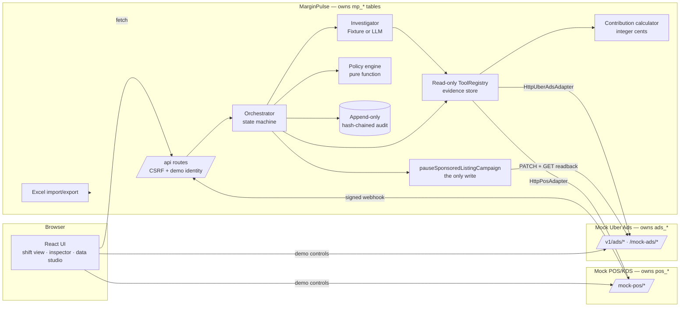

# Architecture

## Topology

One local Node process (Fastify, bound to `127.0.0.1`) hosts three logically separate systems that talk to each other **over real HTTP** through adapters, plus the React UI as static files.



## Control loop

```
POS event (HMAC) → dedupe (event id) → RECEIVED → ASSESSING
  → investigator calls read-only tools (memoized evidence)
  → orchestrator re-reads the same evidence deterministically
  → agent report validated (schema, scope, citations, cited values, banned claims)
  → policy engine (ordered checks, first failure decides)
  → NO_ACTION | NEEDS_REVIEW | BLOCKED | RECOMMENDATION_READY → AWAITING_APPROVAL
  → manager approval (role + store + campaign + action + policy version + TTL)
  → execution checks (approval match, policy unchanged, recommendation fresh)
  → pre-write re-read (ACTIVE, same version, store-scoped, UPDATE)
  → reserve idempotency key → PATCH once → readback(s)
  → PAUSE_VERIFIED only if configured=PAUSED and effective maps to NOT_SERVING
```

The agent never sees a write tool. The policy engine reads tool-produced evidence, never the agent's prose. The UI holds no business state; every screen is rebuilt from `GET /api/investigations/:id`, which includes one live read of the campaign from the Ads adapter.

## Data ownership

| Prefix | Owner | Contents |
|---|---|---|
| `pos_*` | Mock POS/KDS | stores, kitchen snapshots, cost profiles, outbox, faults |
| `ads_*` | Mock Uber Ads | accounts, account stores, token hashes, campaigns, reports, mutation ledger, request log, faults |
| `mp_*` | MarginPulse | users (demo), store mappings, merchant policies, events, investigations, evidence, approvals, mutation attempts, audit, import batches, clock |

One SQLite file keeps fixture import atomic. Module boundaries are enforced by code: only the owning plugin touches its prefix, and MarginPulse reaches simulators through typed ports over HTTP (`UberAdsPort`, `PosPort`, and the demo-only `SimulatorConsolePort`). Simulator-only observability (digest probe, campaign change log, simulator console) answers "not available" for real providers instead of falling back to SQL.

Two approved exceptions write or read simulator tables directly, and an architecture test (`tests/integration/ports.test.ts`) allows only these:

| File | Why |
|---|---|
| `apps/api/src/imports/importer.ts` | The data studio seeds simulators. Preview, commit and restore run inside one SQLite transaction; going through HTTP would lose that atomicity. |
| `apps/api/src/orchestration/world.ts` | Scenario reset arms simulator faults for the selected demo scenario. |

## Trust boundaries

| Boundary | Control |
|---|---|
| POS → webhook | HMAC-SHA256 over canonical payload (timing-safe compare), Zod schema, event-age check, idempotent insert |
| Browser → API | Double-submit CSRF cookie (`SameSite=Strict`, `HttpOnly`) + header on every mutating route; demo identity header (**not authentication**); role + store assignment checks |
| API → Uber Ads | Bearer token held server-side only, redacted in persisted requests; scopes `ads.campaigns.read/write`; per-campaign `UPDATE` permission |
| Investigator → system | Read-only tools scoped to the investigation's store; output parsed with Zod; citations and cited values checked against stored evidence; banned-claim filter; step budget (8) |
| Spreadsheet → simulators | Values only (formulas, hyperlinks, date cells rejected), size/row/column limits, full validation before preview, re-validation at commit, atomic commit, snapshot for restore; approvals/events/tokens never importable |
| Responses | CSP `default-src 'self'`, `nosniff`, `frame-ancestors 'none'`, `no-referrer` |

## Transaction boundaries and partial failure

- **Assessment** writes evidence and decision rows in the MarginPulse store; it has no external side effects.
- **The pause** spans two systems and cannot be atomic. The sequence is: consume approval → record `IN_FLIGHT` attempt (unique per key+attempt) → PATCH → classify → readback → update attempt status.
  - 2xx with `success` → `SUCCEEDED`, still requires readback to show configured PAUSED and effective NOT_SERVING.
  - 4xx / item `failure` → `FAILED_NOT_APPLIED`; retry is allowed with the same, unexpired approval.
  - 5xx / dropped connection / malformed 2xx → `AMBIGUOUS`; resolved **only by readback** (PAUSED with a newer version → applied; ACTIVE with the observed version → not applied). The write is never blindly retried; an unresolved ambiguity blocks retries until *Check again* resolves it.
  - Configured PAUSED but effective still serving → `PAUSE_REQUESTED_NOT_VERIFIED` (*Pause requested, still serving*), up to five bounded extra readbacks.
- **Known race (TO_VERIFY):** Uber's documented PATCH body has no version/If-Match field, so the pre-write re-read is the only concurrency guard; a change between re-read and PATCH would not be detected by Uber.
- **No compensation:** a pause is not undone automatically. Resume is out of scope and must be a separate, separately authorized decision.

## Time

A simulated world clock (stored in `mp_kv`) is frozen at the scenario start (`2026-10-18T18:31:43-04:00`) and moves only when advanced. All freshness checks use it, so results are deterministic. Wall-clock time is recorded beside each audit event. Propagation delay in the J scenario is modeled in wall-clock milliseconds.

## Deployment assumptions

Local single-user demo. No production authentication, no TLS, no multi-tenant isolation beyond store scoping, SQLite as the store. See [IMPLEMENTATION-STATUS.md](IMPLEMENTATION-STATUS.md) for production gaps.
